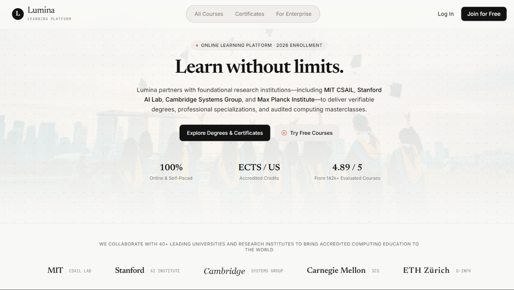
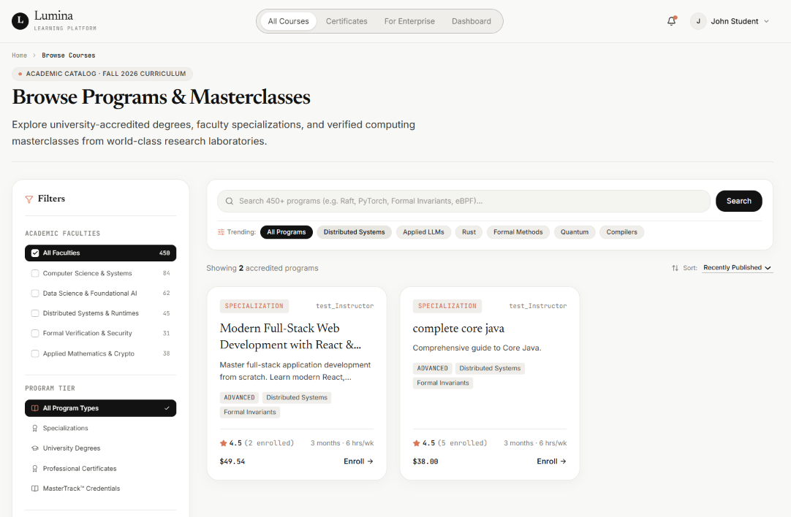
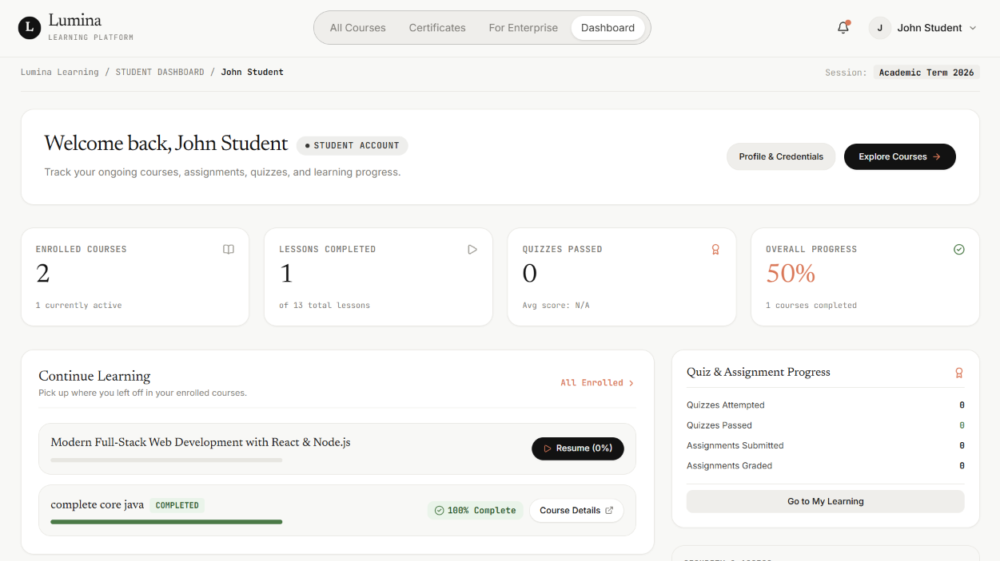
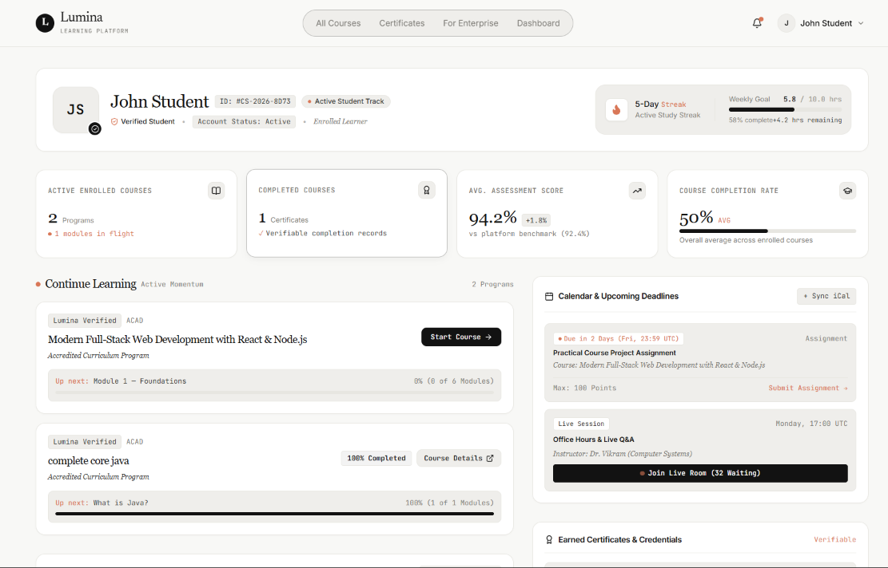
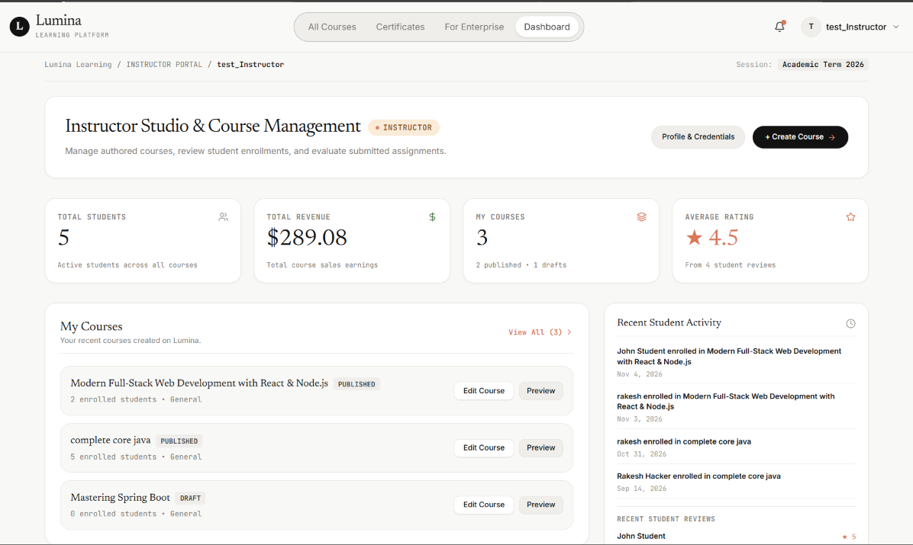
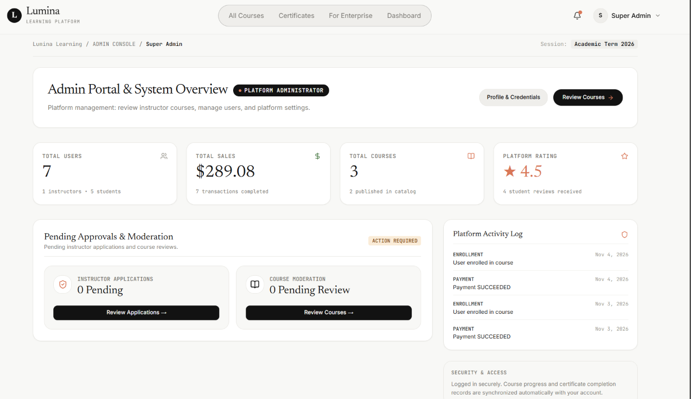
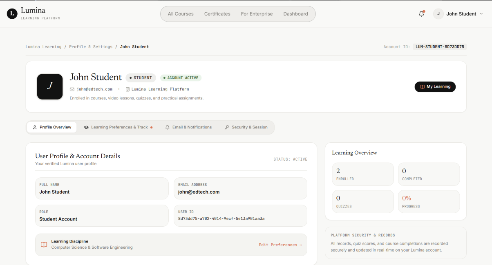

# Lumina — Modern Editorial EdTech Platform 🎓

[](https://react.dev/)
[](https://www.typescriptlang.org/)
[](https://vitejs.dev/)
[](https://tailwindcss.com/)
[](https://reactrouter.com/)
[](https://tanstack.com/query/latest)

> A modern, distraction-free E-Learning and Academic platform designed with a warm editorial aesthetic. Lumina supports multi-role workflows (**Students**, **Instructors**, and **Administrators**), featuring deep course curriculum authoring, auto-graded quizzes, assignment submissions with instructor feedback, interactive learning workspaces, role-based security, and Stripe payments.

---

## 📸 Platform Preview



---

## 📑 Table of Contents

- [Platform Screenshots & Tour](#-platform-screenshots--tour)
  - [1. Landing Page & Editorial Experience](#1-landing-page--editorial-experience)
  - [2. Course Discovery & Catalog](#2-course-discovery--catalog)
  - [3. Scholar / Student Experience](#3-scholar--student-experience)
  - [4. Instructor Studio & Dashboard](#4-instructor-studio--dashboard)
  - [5. Platform Administration & Governance](#5-platform-administration--governance)
  - [6. User Profile & Account Settings](#6-user-profile--account-settings)
- [Key Features](#-key-features)
- [Tech Stack](#-tech-stack)
- [Project Structure](#-project-structure)
- [Getting Started](#-getting-started)
  - [Prerequisites](#prerequisites)
  - [Installation & Setup](#installation--setup)
  - [Environment Variables](#environment-variables)
  - [Development & Build Scripts](#development--build-scripts)
- [How to Embed Screenshots in Markdown](#-how-to-embed-screenshots-in-markdown)

---

## 🖼️ Platform Screenshots & Tour

All application screenshots are stored locally in [`public/images/`](./public/images/) and linked via relative paths so they render across GitHub, GitLab, and local markdown previewers.

### 1. Landing Page & Editorial Experience
The public landing page features Lumina's signature warm-canvas aesthetic, pill navigation bar, search exploration, accredited partner institution marquee, featured curricula, and platform testimonials.


---

### 2. Course Discovery & Catalog
A comprehensive course catalog with instant keyword search, faculty category filters, difficulty tags, and pagination.



---

### 3. Scholar / Student Experience
Students have access to an authenticated scholar dashboard tracking real-time learning progress, current course milestones, and a dedicated learning engine.

| **Student Dashboard** | **My Learning Workspace** |
| :---: | :---: |
|  |  |
| *High-level overview of enrolled courses, completions, and metrics.* | *Focused view of in-progress courses, assignments, and curriculum outline.* |

---

### 4. Instructor Studio & Dashboard
Instructors can create courses, build modular sections and lessons (text, video), author quizzes and project assignments, inspect student enrollment metrics, and submit courses for admin review.



---

### 5. Platform Administration & Governance
Admins manage platform integrity through a centralized control panel, reviewing pending course submissions, inspecting curriculums, approving or rejecting courses, and verifying new instructor applications.



---

### 6. User Profile & Account Settings
Personalized profile management where users can update bio details, expertise areas, email notification preferences, and view account roles.



---

## 🌟 Key Features

### 🏢 Public & Discovery
* **Warm Editorial Aesthetic**: Built with a custom Bauhaus and typography-led design system.
* **Pill Navigation Bar**: Quick-access capsule bar with active route detection and authenticated dashboard links.
* **Course Catalog**: Filter by faculties, search by topics, and inspect detailed course syllabus pages.
* **Institutional Pages**: About, Contact, Terms of Service, and Privacy Policy.

### 🎓 Student Experience
* **Secure Authentication**: Role-based access control with JWT authentication.
* **Interactive Learning Workspace**: Step-by-step progress tracking with video and long-form reading modules.
* **Quizzes & Assessments**: Real-time quiz evaluation with instant score feedback.
* **Assignment Submissions**: Project uploads with instructor review workflows and grade tracking.
* **Stripe Payments**: Safe course enrollment with Stripe checkout (success & cancel redirect handlers).
* **Notification Center**: Real-time alerts for grade postings, course publications, and announcements.

### 👨‍🏫 Instructor Studio
* **Instructor Analytics**: Real-time telemetry on student signups, revenue, and active course performance.
* **Curriculum Builder**: Modular course construction into structured sections and individual lessons.
* **Assessment Authors**:
  * **Quiz Editor**: Set questions, multiple options, correct answers, and passing grades.
  * **Assignment Editor**: Define requirements, guidelines, and point scales.
* **Course Moderation Submission**: Submit draft courses for administrative approval.

### 🛡️ Admin Governance
* **Course Moderation**: Review all pending courses, inspect lessons/quizzes, and approve or reject submissions with feedback.
* **Instructor Verification**: Verify credential applications for users applying to become instructors.
* **System Metrics**: Platform-wide metrics on student enrollments, course catalogs, and activity logs.

---

## 🛠️ Tech Stack

### Frontend Architecture
* **Library**: [React 19](https://react.dev/)
* **Language**: [TypeScript](https://www.typescriptlang.org/)
* **Build Tool & Dev Server**: [Vite 8](https://vitejs.dev/)
* **Styling**: [Tailwind CSS v4](https://tailwindcss.com/) with `@tailwindcss/vite`
* **Routing**: [React Router v7](https://reactrouter.com/) with Role Route Guards
* **Server State & Caching**: [TanStack Query v5](https://tanstack.com/query/latest)
* **HTTP Client**: [Axios](https://axios-http.com/) with authorization interceptors
* **Iconography**: [Lucide React](https://lucide.dev/)
* **Linter**: [Oxlint](https://oxc.rs/)

### Backend Integration
* **API Framework**: Spring Boot (Java)
* **Database**: PostgreSQL
* **Authentication**: JWT Bearer Tokens
* **Payments**: Stripe API

---

## 📁 Project Structure

```text
frontend/
├── public/
│   └── images/                # Application screenshots & static assets
│       ├── landing_page.png
│       ├── all_courses.png
│       ├── student_dashboard.png
│       ├── mylearning.png
│       ├── instructor_dashboard.png
│       ├── admin_dashboard.png
│       └── profile.png
├── src/
│   ├── app/                   # Root providers and React Router definition
│   ├── auth/                  # AuthContext, token management, useAuth hook
│   ├── components/            # Reusable UI component library
│   │   ├── course/            # Course cards, syllabus, and curriculum components
│   │   ├── home/              # Hero, marquee, testimonials, and FAQ sections
│   │   ├── instructor/        # Course and lesson builder widgets
│   │   ├── student/           # Quiz and assignment viewports
│   │   └── ui/                # Buttons, inputs, ratings, typography, error boundaries
│   ├── features/              # Feature modules (API queries, mutations, types)
│   │   ├── admin/             # Verification and moderation queries
│   │   ├── assignment/        # Assignment submission & grading
│   │   ├── courses/           # Course fetching & filtering
│   │   ├── dashboard/         # Aggregated metrics
│   │   ├── instructor/        # Instructor studio queries
│   │   ├── notifications/     # Notification polling
│   │   └── quiz/              # Quiz submission & state
│   ├── layouts/               # PublicLayout, AuthenticatedLayout, Header, and Footer
│   ├── pages/                 # Page routes (public, student, instructor, admin)
│   ├── routes/                # ProtectedRoute and RoleRoute guards
│   ├── lib/                   # Axios client and queryClient setup
│   └── index.css              # Tailwind v4 theme tokens and global styles
├── package.json
├── tsconfig.json
└── vite.config.ts
```

---

## 🚀 Getting Started

### Prerequisites
* **Node.js**: v18.0.0 or higher
* **npm** (or **pnpm** / **yarn**)

### Installation & Setup

1. **Clone the repository**:
   ```bash
   git clone <repository-url>
   cd Edunet
   ```

2. **Install project dependencies**:
   ```bash
   npm install
   ```

3. **Configure Environment Variables**:
   Copy the example environment file:
   ```bash
   cp .env.example .env
   ```

   Update `.env` with your backend server URL and Stripe key:
   ```env
   VITE_API_URL=http://localhost:8080
   VITE_STRIPE_PUBLIC_KEY=pk_test_your_stripe_key
   ```

4. **Launch the development server**:
   ```bash
   npm run dev
   ```
   Open [http://localhost:5173](http://localhost:5173) in your browser.

### Development & Build Scripts

| Command | Action |
| :--- | :--- |
| `npm run dev` | Runs the Vite development server with Hot Module Replacement (HMR) |
| `npm run build` | Compiles TypeScript and runs production bundling via Vite |
| `npm run preview` | Locally previews the production build output from `dist/` |
| `npm run lint` | Runs the Oxlint static analysis tool for fast linting |

---

## 💡 How to Embed Screenshots in Markdown

To display images stored in your repository directly in your `README.md`, reference them via relative paths from the root of the project:

### Standard Markdown Syntax
```markdown

```

### Side-by-Side Comparison (Markdown Table)
```markdown
| Left Image Title | Right Image Title |
|:---:|:---:|
|  |  |
```

### HTML Syntax with Custom Dimensions
```html
<p align="center">
  
</p>
```
